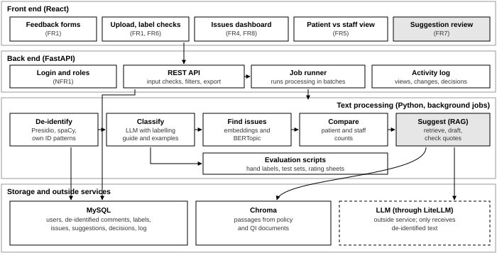
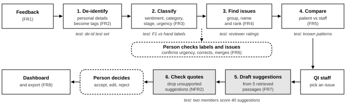

# P3: Requirements and Design

COMP 4310 Web Health Informatics, Lakehead University
**Draft, not yet submitted.** Member roles, dates and targets still need team sign-off.

This mirrors the PDF. Student IDs are in the submitted version only, since this repo is
public.

## 1. Refined Project Direction

**Problem.** Hospitals collect a lot of written feedback, but quality-improvement (QI) teams rarely have time to read it [1]. Patient complaints and staff reports are also kept apart, even though they often describe different sides of the same problem [2].

**Gap from P2.** We did not find a published, openly evaluated approach that does three things together: compares patient and staff feedback, works out the stage of care from the comment, and turns findings into cited suggestions that a person checks. The only study that tried to find the stage of care from complaint text agreed with human coders in about 61-68% of cases [3]. Press Ganey and NRC Health advertise overlapping AI features [4], [5]. When we say they lack a feature, we mean we could not find it in their public documentation, not that we confirmed it is missing.

**Our contribution.** Kaizen is a web app that removes personal details from feedback, labels each comment, groups similar comments into recurring issues, places each issue on the care pathway, and shows where patients and staff agree or disagree. For a chosen issue, it drafts suggestions with citations that a QI staff member accepts, edits or rejects. We will test each step against our own hand labels.

**Changes since P1.** From P2: more than one topic per comment, the HCAT stages of care [6], urgency confirmed by a person, and a patient vs staff comparison. From the feedback on P0-P2:

- **Narrower data:** only English written comments about adult inpatient and emergency care, from patients and families (survey comments and complaints) and from nurses and physicians (short feedback reports).
- **Actionable suggestion defined:** it must name a specific change, who would own it, the stage of care it targets, a measure to check whether it worked, and at least one cited source.
- **Priorities:** we rank every feature as Must, Should or Could. The Must items make up the minimum version and must work and be evaluated by P4: CSV upload, de-identification, classification, grouping into issues, the patient vs staff view, confirming urgency and stage, and a dashboard of ranked issues with their comments. Should items come after P4: suggestions, the web form, renaming and merging issues, and dashboard filters and export. Could items are built only if time allows: trend charts, a rising-issue flag and an improvement tracker. Discharge stays our main test case, since it is one of Ontario hospitals' most chosen QI indicators [7].

## 2. Functional and Non-Functional Requirements

The main users are QI staff. Unit managers view issues for their own unit, an administrator manages accounts, and patients, families and clinical staff submit feedback. Table 1 shows what each user needs, and Table 2 turns these needs into requirements. The Priority column uses the Must, Should and Could levels defined in Section 1.

**Table 1. User stories**

| As a... | I want to... | so that... | FR |
|---|---|---|---|
| QI analyst | upload a month of comments as a CSV | I analyse all of them, not a sample | FR1, FR2 |
| QI analyst | see the top recurring issues with the comments behind each | I know what to work on first | FR3, FR4, FR8 |
| QI analyst | see whether patients, staff or both report an issue | I catch problems one group misses | FR5 |
| QI analyst | confirm or correct the urgency and stage the system suggests | I can trust the results | FR6 |
| QI analyst | get draft improvement ideas with sources for an issue | I have a starting point for a PDSA cycle | FR7 |
| Unit manager | filter issues to my unit | I see what affects my ward | FR8 |
| Patient or nurse | submit feedback through a simple form | my concern is recorded with my details removed | FR1, FR2 |

**Table 2. Functional requirements**

| ID | Requirement | Users | Priority | How we will check it |
|---|---|---|---|---|
| FR1 | Accept feedback through CSV upload and a web form, recording the source (patient/family or staff), unit and date. | Patients, staff, QI staff | Must (form: Should) | A 1,000-row test file loads; bad rows are reported. |
| FR2 | Replace names, dates, phone numbers, emails, health card and record numbers with tags before a comment is saved or sent to the LLM. | System | Must | De-identification test set (Section 5). |
| FR3 | Label each comment with sentiment, one or more HCAT problem categories, a stage of care and a suggested urgency. | System | Must | Compare with hand-labelled test set. |
| FR4 | Group similar comments into named issues, ranked by number of comments, negativity and urgency. Flag issues whose weekly count rises sharply. | QI staff | Must (rising flag: Could) | Reviewers rate the top issues; a built-in rising problem is flagged. |
| FR5 | Show patient and staff feedback side by side by topic, stage and unit, and mark where only one group reports a problem. | QI staff, managers | Must | Known patterns in the synthetic data appear correctly. |
| FR6 | Let QI staff confirm urgency, correct labels, and rename or merge issues. Every change is logged. | QI staff | Must (rename, merge: Should) | Each change creates a log entry. |
| FR7 | Draft two or three cited suggestions for a chosen issue, which QI staff accept, edit or reject. | QI staff | Should | Every shown suggestion passes the citation check. |
| FR8 | Dashboard with ranked issues and the comments behind each, plus filters and CSV export. Could: trend charts and an improvement tracker. | Managers, admin | Must (filters, export: Should; charts, tracker: Could) | Export matches the filtered view. |

**Table 3. Non-functional requirements**

| ID | Quality | Requirement | How we will check it |
|---|---|---|---|
| NFR1 | Privacy and security | Original text is never stored or sent to the LLM. Role-based access, hashed passwords, and a log of who viewed or changed what. Designed around Ontario's PHIPA [8], though only synthetic and public data are used. | Inspect the database and LLM requests; test each role. |
| NFR2 | Reliable AI output | No AI output is final until a person confirms it. Suggestions only use retrieved passages, and any suggestion whose quote is not found in its source is dropped. | Automatic citation check; manual review of 40 suggestions. |
| NFR3 | Performance | 1,000 comments processed within 15 minutes; dashboard pages load within 2 seconds. Processing runs in batches because QI teams review feedback weekly or monthly, and 15 minutes leaves room for API rate limits on a student account. | Timing script. |
| NFR4 | Usability and accessibility | The comments behind the top issue are reachable in three clicks or fewer; meets WCAG 2.1 AA contrast and keyboard rules. | Five-person task test with SUS questionnaire; accessibility scan. |
| NFR5 | Reproducibility | Library and model versions, prompts, seeds and the labelling guide are saved; one command reruns the evaluation. | A second member reruns it and gets the same results. |

FR5 addresses the first part of the gap (patient and staff feedback together), FR3 and FR6 the second (stage of care, suggested by the system and corrected by a person), and FR7 with NFR2 the third (cited, human-checked suggestions). FR2 and NFR1 cover privacy.

## 3. System Design

Kaizen has a React front end, a FastAPI back end, a MySQL database, and a Python text-processing package that the back end runs as a background job when feedback is imported (Figure 1). Each comment then moves through the steps in Figure 2, and the results are saved to MySQL for the dashboard.

*Figure 1. System architecture. White parts are Must items (the minimum version) and grey parts are Should items. Could items are not shown. Only the de-identify step sees original text.*

**Table 4. Main components**

| Component | Responsibility |
|---|---|
| Front end | Forms, upload, dashboard, comparison view, and screens for checking labels and suggestions. Talks only to the back end. |
| Back end | Login and roles, input checks, serving data, starting processing jobs, and the activity log. |
| De-identify | Presidio with spaCy [9] plus our own patterns for Ontario health card and record numbers. |
| Classify | An LLM labels each comment using our labelling guide and a few examples, returning fixed-format JSON. |
| Find issues | Groups comments by meaning with BERTopic [10]; the LLM names each group; groups are ranked. |
| Compare | Counts patient and staff comments per topic, stage and unit, and flags cells where only one group reports a problem. |
| Suggest (RAG) | Retrieves the five most relevant document passages, asks the LLM for suggestions that quote them, and drops any quote not found in its source. |

**Role of AI.** The LLM is used in three places: labelling comments, naming issues, and drafting suggestions. Grouping uses sentence embeddings. In every case the output is shown as "suggested" until a person confirms it, and each use is evaluated separately (Section 5).

*Figure 2. Processing steps, human checks (dashed) and how each step is tested. Steps 1 to 4 are Must items and steps 5 and 6 (grey) are Should items.*

### 3.1 Labels and data

Instead of inventing categories, we use the Healthcare Complaints Analysis Tool (HCAT) [6], which has been tested for reliability. A labelling guide with a definition and two examples per label will be written in week 1.

**Table 5. Labels**

| Label | Options |
|---|---|
| Sentiment | positive, neutral, negative |
| Problem category (one or more) | The seven HCAT categories: quality, safety, environment, institutional processes, listening, communication, respect and patient rights |
| Stage of care | HCAT stages: admissions, examination and diagnosis, care on the ward, operations and procedures, discharge and transfers; plus "unclear" |
| Urgency | low, medium, high (based on HCAT severity; always confirmed by a person) |

- **Synthetic comments:** about 1,500 patient and 800 staff comments generated by an LLM from templates. Eight known problems are built in (for example, delayed discharge medications reported by both groups, and night noise reported only by patients) so we can check whether Kaizen finds them. One of them grows week by week, to test the rising-issue flag.
- **Public comments:** the labelled NHS Friends and Family Test comments from pxtextmining [11], if the licence allows.
- **Hand-labelled test set:** 400 comments labelled in Label Studio. 100 are used to refine the guide and as prompt examples; 300 are kept aside for testing only. Two members label the first 100 separately, and we aim for a Cohen's kappa of at least 0.6.
- **Documents for suggestions:** 30-50 Ontario quality standards, QIP guidance and sample hospital policies we write ourselves.

## 4. Technology Selection and Justification

**Table 6. Main technologies**

| Technology | Role | Why |
|---|---|---|
| Python 3.12, FastAPI | Back end, processing | All the NLP libraries we need are in Python. FastAPI documents the API automatically, so front-end work can start early. Our CI already uses Python 3.12. |
| React, TypeScript | Front end | Chosen in P0, and familiar to the team. |
| MySQL | Database | Labels, decisions and logs are tabular and filtered by unit, stage and date. The team knows it, and the data is small. |
| Presidio, spaCy | De-identification | Free, runs locally so raw text never leaves our machine, and accepts custom patterns. |
| LLM through LiteLLM | Labelling, naming, suggestions | Lets us swap hosted or local models without code changes. A cheap model labels comments; a stronger one is used only for suggestions. |
| scikit-learn, Hugging Face | Baseline models | Simple models often work well (P2), so the LLM has to beat them to justify its cost. |
| BERTopic | Finding issues | Groups comments by meaning and does not need the number of groups in advance. |
| Chroma | Document search for suggestions | Runs inside our Python code; enough for a few thousand passages. |
| Label Studio | Hand labelling | Free and supports more than one label per comment. |
| GitHub, pytest, Docker Compose | Teamwork, testing, running the app | Our repository already requires reviewed pull requests and runs CI checks. Docker Compose starts the whole app locally with one command, so no cloud hosting is needed. |

## 5. Implementation and Evaluation Plan

**Table 7. Timeline** (weeks from November 9; dates will be matched to D2L deadlines)

| Week | Tasks | Deliverable |
|---|---|---|
| 1 (Nov 9) | Labelling guide, synthetic data, database and API design, project setup. | Guide and data in repo |
| 2 (Nov 16) | Label 100 comments; build de-identification and classification; CSV upload. | Agreement score |
| 3 (Nov 23) | Label test set; build issue grouping, comparison and dashboard; first evaluation. | **P4:** all Must items working, with first results |
| 4 (Nov 30) | Collect documents; build suggestions, citation check and review screen; add the web form, filters, export, and renaming and merging issues. | Should items working |
| 5 (Dec 7) | Rate suggestions, usability and timing tests; Could items only if time allows. | Final results |
| 6 (Dec 14) | Final report, setup guide, demo video. | **Final project** |

**Table 8. Responsibilities** (everyone helps label and reviews pull requests)

| Member | Area | Requirements |
|---|---|---|
| Hemanth Reddy Basireddy | Import, de-identification, database | FR1, FR2, NFR1 |
| Hujaifa Muaz | Classification, issue grouping, labelling guide | FR3, FR4 |
| Mohammed Asrar Ali | Suggestions and document collection | FR7, NFR2 |
| Aansh Amitabh Arora | Front end and dashboard | FR5, FR6, FR8, NFR4 |
| Bhavya Bhatt | Synthetic data, evaluation scripts, testing | NFR3, NFR5 |

### 5.1 Evaluation

Model results come from the 300 held-out comments and are reported separately for public and synthetic data, since LLM-written comments may be easier for an LLM to label. Each requirement's check in Tables 2 and 3 is also written as an automated test where possible.

**Table 9. Evaluation targets**

| What | Method | Target |
|---|---|---|
| De-identification | 150 test comments with about 300 fake personal details, including hard cases such as names that are ordinary words ("Rose") and mixed date formats. Runs on every pull request. | Finds 95% overall and all ID numbers, phones and emails |
| Sentiment | LLM and baseline vs hand labels | Macro F1 ≥ 0.75 |
| Problem category | Same, also reported per category | Micro F1 ≥ 0.70 |
| Stage of care | Agreement with hand labels, compared with 61-68% in [3] | ≥ 65% |
| Urgency | Share of truly urgent comments that get flagged | ≥ 80% |
| Issues | Two members read 10 comments from each of the top 15 issues. An issue is good if at least 8 are about the same problem and its name describes a specific process. We also count how many of the 8 built-in problems are found. | ≥ 70% of issues good; ≥ 6 of 8 found |
| Suggestions | Two members score 40 suggestions from 0 to 2 on *relevance* (addresses this issue at this stage), *actionability* (has all five parts from Section 1) and *citation support* (the cited passage backs every claim). Any suggestion about an individual patient's treatment is marked unsafe. We compare with the same LLM given no documents. | ≥ 70% score 5 or 6; none unsafe |
| Usability | Five classmates do four tasks, then fill in the SUS questionnaire. | SUS ≥ 68 |

### 5.2 Risks

**Table 10. Risks and mitigation**

| Risk | Mitigation |
|---|---|
| Data may be unrealistic: we have no real staff feedback. | Hand-labelled test set, separate results for public and synthetic data, varied writing styles, and a clear statement of this limit. |
| Labels, especially stage of care, may miss targets. | Prompt examples, an "unclear" option, falling back to the baseline if it does better, and human correction. Results are reported as they are. |
| Suggestions may be wrong or unsupported. | Retrieved passages only, automatic quote checks, and a required human decision. As a Should item, it cannot hold up the Must items. |
| Falling behind at the end of term. | Strict priority order, an API agreed in week 1 so front and back end are built in parallel, weekly merges, and a P4 that covers only the Must items. |

## References

1. L. Locock et al., "Understanding how front-line staff use patient experience data for service improvement: an exploratory case study evaluation," Health Serv. Deliv. Res., vol. 8, no. 13, 2020.
2. J. van Dael et al., "Getting the whole story: integrating patient complaints and staff reports of unsafe care," J. Health Serv. Res. Policy, vol. 27, no. 1, pp. 41-49, 2022.
3. S. W. C. Koh et al., "Classifying patient complaints using artificial intelligence-powered large language models: cross-sectional study," J. Med. Internet Res., vol. 27, e74231, 2025.
4. Press Ganey, "Press Ganey expands AI capabilities to transform safety and the experience of patients and healthcare employees," News release, Jan. 14, 2025.
5. NRC Health, "Artificial intelligence capabilities." https://nrchealth.com/nrc-health-artificial-intelligence-capabilities
6. A. Gillespie and T. W. Reader, "The Healthcare Complaints Analysis Tool: development and reliability testing of a method for service monitoring and organisational learning," BMJ Qual. Saf., vol. 25, no. 12, pp. 937-946, 2016.
7. Ontario Health, "Highlighting the 2025/26 QIP indicator matrix and selection trends," Quorum. https://quorum.hqontario.ca
8. Government of Ontario, Personal Health Information Protection Act, 2004, S.O. 2004, c. 3, Sched. A.
9. Microsoft, "Presidio: data protection and de-identification SDK." https://microsoft.github.io/presidio/
10. M. Grootendorst, "BERTopic: Neural topic modeling with a class-based TF-IDF procedure," arXiv:2203.05794, 2022.
11. The Strategy Unit, "pxtextmining," GitHub repository. https://github.com/the-strategy-unit/pxtextmining
